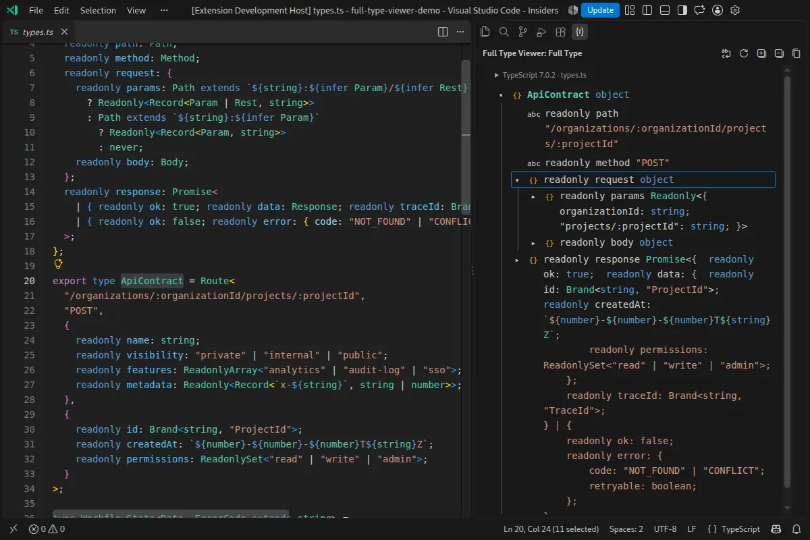
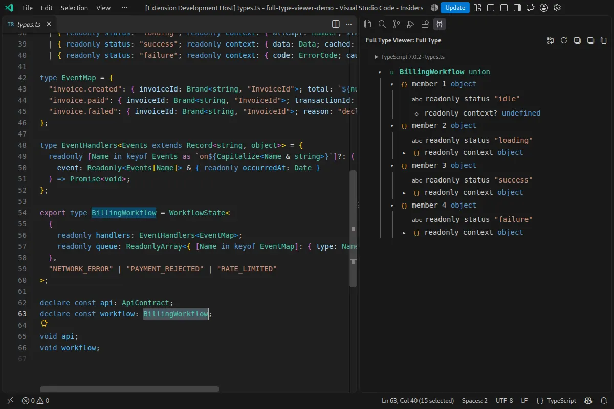

# Full Type Viewer

Full Type Viewer is a VS Code Insiders extension for exploring complete TypeScript 7 semantic types in an expandable sidebar tree. It connects to the TypeScript native-preview server that is already running in VS Code, so the result uses the active project and includes unsaved editor changes.

The extension is useful when hover output is too abbreviated to understand a large union, nested object, inferred schema, or recursive type. It exposes the type one semantic level at a time instead of eagerly expanding the entire graph.

## Screenshots

| Nested API contract | Discriminated workflow union |
| :---: | :---: |
|  |  |

## AI Usage

This app is 100% vibe-coded, it's not a representation of what the author thinks is "good code", but more of a "ends justify the means". If you contribute, please don't put too much energy into it. Honestly don't even read this README, I didn't, it's also slop.


## Features

- Follows the TypeScript identifier under the cursor or a selection within one identifier.
- Shows complete immediate union, intersection, object, array, tuple, generic, callable, constructor, and index-signature structure.
- Expands individual branches lazily and marks recursive edges without looping.
- Copies the visible type as TypeScript without UI glyphs.
- Supports keyboard tree navigation, optional word wrapping, selectable text, and active-theme syntax colors.
- Opens definitions from a node context menu. Right-click a property or symbol label to open that symbol; right-click its displayed type to open the type definition.
- Preserves focus, selection, scrolling, and expansion state while the current symbol is updated.

## Requirements

The current release intentionally targets a narrow experimental environment:

- Linux x64
- VS Code Insiders `1.126` or newer
- [`TypeScriptTeam.native-preview`](https://marketplace.visualstudio.com/items?itemName=TypeScriptTeam.native-preview) `1.0.1`
- TypeScript native preview enabled in a trusted workspace:

```json
{
  "js/ts.experimental.useTsgo": true
}
```

The client is pinned to TypeScript `7.0.2` because the native API protocol is unstable. VS Code Stable, other native-preview versions, JavaScript files, and untrusted workspaces are not currently supported.

## Install

After downloading or building `ts-full-type-viewer-0.0.4.vsix`, install it with:

```sh
code-insiders --install-extension ./ts-full-type-viewer-0.0.4.vsix --force
```

Then run **Developer: Reload Window** in VS Code Insiders.

To build the VSIX from source:

```sh
npm ci
npm run check
npm run package
```

`npm run build` only refreshes `dist/`; it does not update the installable VSIX. Run `npm run package` before reinstalling a changed build.

## Use

1. Open the **Full Type Viewer** Activity Bar container.
2. Place the cursor on a TypeScript identifier, at either its declaration or a use site.
3. Click a compound row to expand or collapse it.
4. Right-click a row and choose **Go to Definition**. **Cancel** or Escape closes the menu.

Keyboard navigation follows the standard tree model: Up/Down moves between visible rows, Right expands or enters a branch, Left collapses or returns to the parent, Home/End jumps to the first or last row, and Enter/Space toggles expansion.

The view-title actions refresh the current symbol, expand the visible frontier by one level, collapse all branches, copy the displayed type, and toggle word wrapping.

## Limitations

- The extension follows the semantic type graph exposed by TypeScript; it cannot create links to source values erased during inference.
- Named and recursive references remain boundaries until explicitly expanded.
- Graph interactions are limited to 5,000 nodes and 2 MB of UTF-8 presentation text. An oversized interaction fails without replacing the last valid view.
- This is not a Marketplace release or a replacement for TypeScript hover and language navigation.

See `DEVELOPMENT.md` for architecture, testing, packaging, and troubleshooting. The behavioral contract is summarized in `SPEC.md`.

## License

Licensed under the permissive 0BSD license. See `LICENSE` for the full text.
